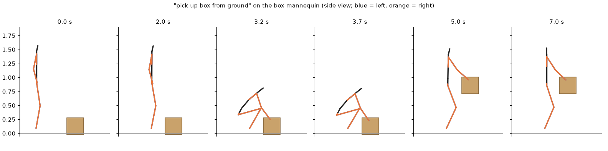

# Forja

Local, free tooling to make game-ready animations for any creature or humanoid: multi-view reading of a rig,
robust triangulation, bounded IK, procedural gaits, physics clean-up with Jolt, and a minimal *gesture from text*
step. Everything runs on our own machines, with no paid services and no accounts.

Forja started as a reproduction of [anymove](https://github.com/patch-gg/anymove) (Apache-2.0) and extends it.
The derived files and the changes are listed in [NOTICE](NOTICE).

By [Sendell](https://sendell.co). Lab notebooks are in Spanish (`docs/`); this README is in English.



*"pick up box from ground" on the bundled box mannequin: Forja's IK with joint limits, the box as a Jolt rigid body
held by the palms, measured against the deformed mesh. Side view; left and right overlap.*

## What is in this repository

| Path | What it does |
|---|---|
| `forja/rig.py` | Forward kinematics of an anymove-style rig in numpy (matches Blender to 0.0003 mm on our test clips) |
| `forja/vistas/` | N orthographic views (front, side, **top**) as affine projections; Blender wrapper for the extra camera |
| `forja/lector/` | Joint reader (anymove's DINOv2 recipe) trained on N views; batch sized for an 8 GB GPU |
| `forja/triangulacion/` | Confidence-weighted triangulation with per-view candidates and Viterbi selection over time |
| `forja/ajuste/` | Robust root fit, bounded Levenberg–Marquardt IK per chain, Huber smoothing, HMM foot contacts |
| `forja/fuentes/` | Procedural N-leg gaits and IK gestures with events |
| `forja/fisica/`, `forja/gesto/*.mjs` | Physics clean-up and contact queries with [Jolt](https://github.com/jrouwe/JoltPhysics.js) in Node |
| `forja/gesto/` | Gesture from text: a sentence → a skeletal clip on your humanoid, plus the box as a physics body |
| `forja/calidad/`, `forja/paquete/` | Metrics, per-second telemetry, GLB export with the original bone names, annotations |
| `ejemplos/` | `maniqui.py` (a box mannequin generated from code) and `palos.py` (the image above) |
| `docs/` | Lab notebooks F0–F4 with numbers, tables and the measured data in `docs/datos/` |

## Measured results (from the notebooks)

- **Top view helps 8-legged creatures (F2).** On four synthetic spider clips with known motion, mean 3D error went
  from 0.70 cm (anymove fit, 2 views) to 0.44 cm (Forja fit, 3 views) on the walk, and the legs that the side view
  hides drop from ~5 cm to under 1 cm of error. See `docs/F2.md` and `docs/img/f2_error_por_pata.png`.
- **Procedural clips cleaned with Jolt (F3).** Foot sliding during stance 0.00–0.015 cm, no ground penetration,
  self-intersections reduced from up to 15 cm to ≤ 0.5 cm.
- **Gesture from text (F4, minimal).** `pick up box from ground` and `put box down`, in English and Spanish templates,
  in ~22–29 s of CPU from sentence to GLB.

These numbers were measured on a game character that is **not** included here (see *Status*).

## Run it

Requirements: Python 3.11+ with numpy, Node 22+ (for Jolt). [uv](https://docs.astral.sh/uv/) is the easiest way to
get numpy without touching your system Python.

```bash
npm ci                                   # installs jolt-physics (MIT)
# 1. make a test character (boxes, 18 bones, generated by code)
PYTHONPATH=. uv run --no-project --with numpy python -m ejemplos.maniqui maniqui.glb
# 2. sentence → clip
PYTHONPATH=. uv run --no-project --with numpy python -m forja.gesto "pick up box from ground" \
    --personaje maniqui.glb --salida salidas/gesto
# 3. optional: the stick-figure sheet
PYTHONPATH=. uv run --no-project --with numpy --with matplotlib python -m ejemplos.palos salidas/gesto palos.png
```

Output in `salidas/gesto/`: `recoger_caja.glb` (the character with one new clip and the animated box),
`recoger_caja.anotaciones.json` (steps, grip, release, foot contacts), `informe.json` (timings and measurements) and
`movimiento.npz`.

### Using your own character

`forja.gesto` reads any skinned GLB with these bone names, Y up, metres, facing +Z, each bone's local Y pointing to
its child (Blender's default export):
`root > pelvis > spine > chest > neck > head`, `chest > upper_arm_L > forearm_L > hand_L` (and `_R`),
`pelvis > thigh_L > shin_L > foot_L` (and `_R`). Extra nodes (sockets, props) are kept as they are.
`ejemplos/maniqui.py` is the reference for the layout. Use a model you own or one with a licence that allows it.

The creature pipeline (`forja.fuentes.fabricar`, `forja.ajuste.ajustar`, the reader) needs an anymove-style
`rig_info.json` and `creature.json` for your creature. The notebooks show the format; no creature is bundled.

## Status (honest)

Works, and was run from this clean copy:
- `ejemplos/maniqui.py` → `forja.gesto "pick up box from ground"`: GLB in ~22 s on a 4-core CPU. On the mannequin the
  palms stay within 1.4 mm of the box faces and the feet slide ≤ 0.23 cm per frame; the boxy forearms touch the box
  by up to 1.8 cm while carrying (the original game character, with real geometry, measured 0.0 cm).

Not included or not runnable from here:
- **No game models.** The spider and the humanoid used in the notebooks are assets of our game and are not
  published; neither are their renders, videos, rig data or collision hulls. Commands in `docs/` that mention them
  (`obrera.glb`, `criaturas/qdt_spider/…`, `salidas/qdt_spider/…`) are kept as a record.
- **The machine scripts** used to run training and Blender renders on a Windows GPU box are not included.
  The notebooks still describe them.
- **The reader (`forja/lector/`)** needs anymove's environment (torch, DINOv2 weights from Hugging Face) and a GPU.
- **Blender previews** (`blender_*.py`) need Blender 5.x; not run in this check.
- **No automated test suite yet.** The check is the demo above plus `python -m compileall`.
- Only two gestures (pick up / put down a box). Phone capture, local video models and retargeting from the plan
  are not started.

## License

Proposed: Apache License 2.0 for Sendell's code ([LICENSE](LICENSE)). Code derived from anymove keeps its
Apache-2.0 licence and attribution: see [NOTICE](NOTICE) and `terceros/`.
